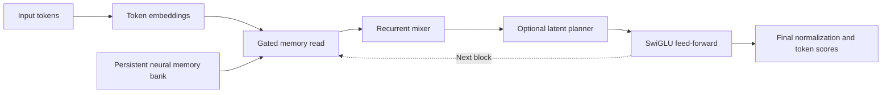

# AURYVETH-NEO

A trainable PyTorch language model that combines an attention-free recurrent backbone with a persistent neural memory bank. The project includes tokenizer and training tools, direct Python chat, and a local service that works with the Ollama CLI. The repository ships source and tests. Checkpoints and datasets are prepared locally.

## Architecture

The main change from the earlier Transformer is the sequence mixer. The recurrent branch replaces causal self-attention with a learned gated update that carries a fixed-width state through the sequence. Persistent memory remains a separate component that each block can read.

| Component | Earlier Transformer path | Recurrent path in AURYVETH-NEO |
| --- | --- | --- |
| Sequence processing | Causal self-attention over the token prefix | A gated diagonal recurrence carries one state vector per layer and sequence |
| Decoding | The included Transformer generator reruns the prefix for each generated token | A chunked parallel scan processes the prompt, then each new token advances the saved states |
| Neural memory | A persistent bank with an attention-based read over selected memory states | The same bank interface selects candidates by cosine similarity, then a learned gate fuses their pooled states into the block |
| Optional planner | The shared model can refine hidden states with a latent planner | The same module can run after recurrent mixing. A separately trained switch checkpoint exposes its predicted states on explicit switch commands |



**Recurrent state and persistent memory serve different purposes.** The recurrence summarizes the active prefix. Its decode cache scales with the number of layers times the hidden width per sequence. The memory bank stores encoded records across checkpoint saves. A separate embedding and bidirectional GRU encode each record. Reads rank regions and records, then incorporate selected states through a learned gate. The checkpoint binds saved records to a compatible memory encoder and tokenizer. The fixed-width cache claim applies to recurrent decoding state. Training activations and the memory bank have separate costs. [Recurrent blocks](model/recurrent.py) · [Neural memory](model/memory.py) · [Checkpoint and encoder](model/integrated.py)

**The planner is opt-in.** Its GRU cell refines a token's causal hidden representation for a configured number of passes. Its residual starts at zero when inserted into an existing model, so the initial insertion preserves the model's output. Ordinary chat returns the checkpoint's decoded reply, including empty or repetitive output. In a bundle with a qualified switch checkpoint, a `think:` request runs one transition at a time and displays the resulting predictions. The switch trace shows task states. General reasoning and reliable open-ended chat have not been established. [Latent planner](model/planner.py) · [Switch inference](scripts/switch_reasoning.py) · [Bundle format](model/neo.py)

The project also exposes optional graph retrieval APIs. The context archive can recover original document text for prompt-based grounding. A separate graph bridge can initialize recurrent state from retrieved evidence. These paths are explicit integrations outside the standard chat request. Existing Transformer checkpoints still use the Transformer path with their original tokenizer. Recurrent weights require separate training. [Context archive](model/context_archive.py) · [Graph bridge](model/graph_bridge.py)

## Install

Use Python 3.11 or later. From the repository root in PowerShell:

```powershell
python -m venv .venv
.\.venv\Scripts\python.exe -m pip install -e ".[test,data]"
.\.venv\Scripts\python.exe -m pytest -q
```

The `data` extra enables the OpenAssistant builder. The trainer uses CPU or CUDA with `--device auto`. CUDA requires a CUDA-enabled PyTorch installation.

## Train a recurrent checkpoint

Place a UTF-8, training-only corpus in `data/train.txt`. Train a tokenizer once and use it for data preparation, model training, and serving. The dialogue builder downloads pinned OpenAssistant data and keeps conversation trees separate across splits.

```powershell
.\.venv\Scripts\python.exe -m scripts.train_tokenizer --input data/train.txt --prefix data/tokenizer_50k
.\.venv\Scripts\python.exe -m scripts.build_conversation_data --tokenizer data/tokenizer_50k.model --out data/dialogue
.\.venv\Scripts\python.exe -m scripts.train `
  --backbone recurrent --width 256 --layers 4 --heads 8 --kv-heads 2 `
  --block-size 1024 --train-seq-len 512 --tokenizer data/tokenizer_50k.model `
  --train-jsonl data/dialogue/train.jsonl --validation-jsonl data/dialogue/validation.jsonl `
  --steps 2000 --out runs/chat
```

For custom dialogue, supply separate train and validation JSONL files. Each row has `prompt`, `answer`, and `context`. Format the prompt as alternating `User:` and `Assistant:` turns and end with `Assistant: `. Use `"context": []` for ordinary dialogue or provide supporting text for supervised memory training. To mix in next-token training on plain text, add `--corpus data/train.txt --validation-corpus data/validation.txt` and keep the validation corpus separate.

The run saves `model.pt`, `best_model.pt`, `training_state.pt`, and the matching tokenizer in a hash-verified manifest. Use `--stop-after` to pause a planned run. Resume with the same command and original total `--steps`, replacing `--stop-after` with `--resume-state runs/chat/training_state.pt`. For a separate fine-tuning run, use `--resume-checkpoint` with the matching tokenizer and a new output directory. [Trainer](scripts/train.py) · [Data preparation](scripts/build_conversation_data.py)

## Run chat

For direct Python chat:

```powershell
.\.venv\Scripts\python.exe -X utf8 -m scripts.chat --checkpoint runs/chat/model.pt --tokenizer runs/chat/tokenizer.model --manifest runs/chat/manifest.json
```

To use the installed Ollama CLI, build a bundle and start the local service:

```powershell
.\.venv\Scripts\python.exe -m scripts.neo_ollama --build --chat-manifest runs/chat/manifest.json
.\.venv\Scripts\python.exe -X utf8 -m scripts.neo_ollama
```

In a second PowerShell session, point the client at the loopback service:

```powershell
$env:OLLAMA_HOST = 'http://127.0.0.1:11435'
ollama run auryveth-neo
```

Inference runs in the PyTorch service. The Ollama CLI is the client for this custom checkpoint. [Local service](scripts/neo_ollama.py)

### Train the optional switch planner

```powershell
.\.venv\Scripts\python.exe -X utf8 -m scripts.train_switch_reasoning --baseline runs/chat/manifest.json --out runs/switch --steps 660
```

The tokenizer must represent `off`, `on`, `关`, and `开` as distinct single tokens within each language. If the resulting manifest reports `cli_qualified: true`, build into a new directory using the original chat manifest and `--think-manifest runs/switch/manifest.json`. Pass the same `--bundle` directory when serving, then enter `think: off toggle keep` in Ollama. [Switch training and qualification](scripts/train_switch_reasoning.py)

## License

Apache 2.0. See [LICENSE](LICENSE).
